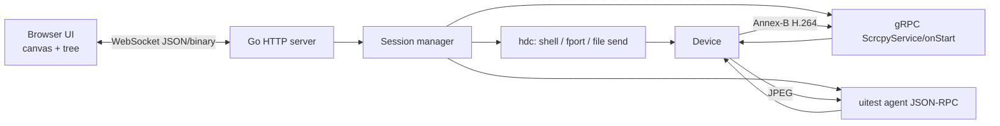

# hoscpygo

A single-binary Go server for HarmonyOS/OpenHarmony device mirroring and control.
It replaces the Java/JavaCV/Swing host of
[HOScrcpy](https://gitcode.com/OpenHarmonyToolkitsPlaza/HOScrcpy) with:

- a Go device/session core (hdc + uitest agent + gRPC H.264),
- an embedded browser UI (no npm build step, no CDN),
- embedded device-side assets (`libscreen_casting` variants + uitest agents),
- an external system hdc (`-hdc`, `$HDC`, or `PATH`; not bundled),
- no JVM, no JavaCV/OpenCV/Tesseract, no CGO.

The browser is the video client: H.264 is decoded with **WebCodecs** when
available, with an **MSE/jmuxer** fallback. The Go process never decodes video.

## Features

- Local and remote (`ip:8710`) hdc devices.
- `-s host[:port]` to use one remote hdc server exclusively, including its
  `hdc list targets` results.
- H.264 video stream (device-side hardware encoder, Annex-B AUs).
- JPEG image-stream fallback (change-driven, typically 1–8 fps) for devices or
  networks where the video extension is unavailable.
- Touch/tap/swipe, mouse drag, wheel, keyboard, toolbar keys, text/IME paste.
- Layout (view hierarchy) dump, tree view, search, bounds highlight, tap center.
- Screenshot (live image frame or `snapshot_display`).
- Settings for mode, scale, fps, bitrate, I-frame interval, remote hdc servers,
  hdc path and listen address.
- Automatic video-server variant selection and H.264 keyframe request on connect.

## Quick start

```bash
make build
./bin/hoscpygo
# open http://127.0.0.1:8899/

# Use only the hdc server running on another machine:
./bin/hoscpygo -s 192.0.2.10:8710
```

`-s` is a per-process override and is not written into the config file. It uses
the local hdc executable but asks it to connect to the given hdc server, so
`hdc list targets` and all device commands come from that server. A bare host
gets port `8710`.

Requirements on the host:

- Linux, macOS (amd64/arm64) or Windows (amd64).
- A Chromium browser with H.264 WebCodecs/MSE support (Chrome/Edge).
- hdc is not embedded. It must be resolvable via `-hdc`/config, `$HDC`, or
  `PATH`; otherwise startup fails with an installation hint. Install the
  HarmonyOS/OpenHarmony command-line tools and put `hdc` on `PATH`.
- A device with USB debugging (or a reachable hdc server on port 8710).

Flags:

```
-listen 127.0.0.1:8899   HTTP listen address
-config <path>           config file (default: user config dir/hoscpygo/config.json)
-hdc <path>              hdc executable
-s <host[:port]>         use only this hdc server (default port 8710)
-no-open                 do not open the browser
-debug                   debug logging
-version                 print version
```

URL shortcuts:

- `/?sn=<serial>` selects and connects a device.
- `/?session=<id>` attaches to an existing session.

## Cross builds

```bash
make dist
# dist/hoscpygo-linux-amd64
# dist/hoscpygo-darwin-amd64
# dist/hoscpygo-darwin-arm64
# dist/hoscpygo-windows-amd64.exe
```

`CGO_ENABLED=0` is used for every target. Each artifact is a single file with
the web UI and all device `.so` assets embedded. hdc is an external host
prerequisite (resolved from `-hdc`, `$HDC`, or `PATH`), not bundled.

## Architecture



Two capture paths:

| | Video | Image |
|---|---|---|
| Device asset | `internal/assets/device/server_unix_6.5.z.so` etc. | `agent_1.2.3.so` |
| Loader | `/system/bin/uitest start-daemon singleness --extension-name hoscpy_server.z.so ...` | `uitest start-daemon singleness --extension-name hoscpy_agent.so` |
| Transport | gRPC over `localabstract:scrcpy_grpc_socket` (or `tcp:5000` for legacy assets) | raw JSON + JPEG on a separate forwarded socket |
| Protocol | `ScrcpyService/onStart` server stream; `payload["data"].val_bytes` | `Captures.startCaptureScreen` |
| Rate | encoder rate (static screens send nothing) | change-driven, typically 1–8 fps |
| Host decode | browser (WebCodecs/MSE) | browser `createImageBitmap` |

Every fport is created **after** the device-side abstract socket exists. This
matters: an hdc forward created too early silently points at nothing.

## Protocol summary

Exact proto recovered from the vendor SDK (no package):

```proto
message ReplyMessage {
  string data = 1;
  int32 reply_type = 2;
  map<string, ParamValue> payload = 3;
}
message ParamValue {
  oneof values {
    int64 val_int = 1; double val_double = 2; string val_string = 3;
    bool val_bool = 4; bytes val_bytes = 5; float val_float = 6;
  }
}
message ReplyEndMessage { int32 result = 1; }
message Empty {}
service ScrcpyService {
  rpc onStart(Empty) returns (stream ReplyMessage);
  rpc onEnd(Empty) returns (ReplyEndMessage);
  rpc onRequestIDRFrame(Empty) returns (ReplyEndMessage);
}
```

Device server variants are selected from `uitest --version`:

| uitest version | assets |
|---|---|
| > 6.0.2.1 | `server_unix_6.5` → `6.4` → `6.3.1` (abstract socket) |
| ≤ 6.0.2.1 | `server_5.10` → `server3` → `server2` → `server1` (TCP :5000) |

The uitest agent is selected similarly (`agent_1.2.3` for H7). Agent frames use:

```
"_uitestkit_rpc_message_head_" + uint32(1145141919) + uint32(len) + body +
"_uitestkit_rpc_message_tail_"
```

The 4-byte word is a **magic**, not a session id; using a counter makes
`captureLayout` time out. Control calls (`Gestures`, `callHypiumApi`) are sent as
raw JSON. `touchDown/Move/Up` is a no-op on H7; input uses Hypium
`Driver.click/swipe/longClick` for touch semantics and `Gestures`
`ButtonLeft*`/`Axis*`/`uinput` for real-time mouse/wheel.

## HTTP/WS API

- `GET /api/health`
- `GET /api/devices`
- `POST /api/connect {sn,server,mode}` → `{session,state}`
- `GET /api/session/{id}` | `/size` | `/layout` | `/screenshot`
- `POST /api/session/{id}/mode {mode}` | `/input` | `/disconnect`
- `GET/POST /api/config`
- `GET /ws?session={id}` — binary H.264/JPEG frames; JSON state/errors.

WS input messages: `touch` (`down/move/up`), `tap`, `swipe`, `mouse`, `wheel`,
`key`, `text`, `rotate`.

## Verified on

| Device | OS | Video | Image/layout/input |
|---|---|---|---|
| device-A | HarmonyOS 7.0.0.17 (API 26, uitest 6.0.2.3) | ✅ 630×1360 High profile | ✅ |
| device-B | HarmonyOS 7.0.0.21 (root/eng) | ✅ | ✅ |
| device-C | HarmonyOS 7.0.0.257 | expected ✅ | expected ✅ |

Measured: H.264 SPS/PPS+IDR ~32/202–45 KB, P frames ~3–9 KB at scale 2/8 Mbps;
layout 58–180 KB; image stream ~8.4 fps at scale 0.5 under continuous input;
Go `image/jpeg` decode ~13 ms for 640×1360.

## Native `.so` / signature observations

The vendor server/agent `.so` files **do carry an appended Huawei CBG PKCS#7
signed-data block** (signer `DevEcoTesting Release`, Huawei CBG Software Signing
Service CA). However, reverse-engineering analysis of
`OHOS::uitest::ExecuteExtension` shows the loader only does `dlopen`, `dlsym`,
`OnInit`, `OnRun`; **it does not call a signature verifier**. We found no
signature-related strings in the inspected `ld-musl`, but a lower-layer check
cannot be fully ruled out.

An earlier claim that unsigned extensions cannot load was based on tests with
confounders (file mode `0644` → `Dlopen: Permission denied`, wrong 2-argument
`OnInit` ABI, and a daemon that logged `StartDaemon: Failed to initialize
server` before a meaningful extension test). It is therefore **not established**
that Huawei signing is required by this loader. See
[`native/README.md`](native/README.md) for the open-source analysis, signature parse,
and test caveats.

Current scope: Go host + embedded device assets. The self-built C++ server is
embedded as `server_static.z.so` and is tried first for unix-socket systems. It
uses the public `OH_AVScreenCapture` + `OH_VideoEncoder` APIs and statically
links protobuf 33.5, gRPC 1.73, and libc++, so it does not need the PC's
`libprotobuf.z.so`/`libgrpc*.z.so` ABI. It serves the existing `ScrcpyService`
protocol and produces decodable 2880×1920 H.264 on the tested PC. If it fails to
start on another device, the vendor assets remain as fallbacks. See
[`native/server/README.md`](native/server/README.md). This is still a probe:
display geometry is fixed, the capture path is change-driven, and one stream is
supported.

## Security

- The HTTP server binds `127.0.0.1` by default and has no authentication. The
  hdc/gRPC/uitest channels are plaintext. Expose it only behind SSH/VPN or a
  trusted reverse proxy; do not bind `0.0.0.0` on an untrusted network.
- The tool can inject input and run shell commands on the device. Only connect
  devices you control.
- The device `.so` is pushed with an md5 check, but `/data/local/tmp` is
  writable by the device shell. Treat the device as trusted.
- hdc is resolved from the system. Use a trusted copy (DevEco/OpenHarmony
  command-line tools) and keep it on `PATH`; the application no longer carries
  its own copy.

## Licensing

The Go code is MIT (see `LICENSE`). The embedded `internal/assets/device/*.so`
are third-party/Huawei binaries and are **not** covered by that license; see
`NOTICE`. hdc is not bundled. If you redistribute this binary, confirm
that you have the right to redistribute those assets. The safe alternative is
to load them at runtime from a user-provided official SDK jar.

## Troubleshooting

### HarmonyOS PC 7.0.0.1: `MapFieldBase11SetMapDirty ... symbol not found`

The bundled video servers (`server*.z.so`) link against the system
`libprotobuf.z.so` and import `google::protobuf::internal::MapFieldBase::
SetMapDirty`. Some HarmonyOS PC builds ship a newer protobuf that no longer
exports that symbol, so the `.so` cannot be relocated:

```
Dlopen /data/local/tmp/hoscpy_server.z.so failed:
Error relocating ... _ZN6google8protobuf8internal12MapFieldBase11SetMapDirtyEv:
symbol not found
```

This is a device-side ABI mismatch, not a Windows, hdc or Go error. All bundled
server variants reference the same symbol. Immediate workaround:

- use **image mode** (UI "图片 JPEG", config `"mode": "image"`, or
  `POST /api/connect {"mode":"image"}`): control, layout, screenshot and a
  lower-rate JPEG stream still work (the agent does not use protobuf);
- request a newer ABI-compatible `libscreen_casting`/SDK asset built for the PC
  OS from Huawei, then add it as a new variant in `internal/scrcpy`;
- or use the self-built static server embedded as `server_static.z.so`. It is
  tried before the vendor variants for unix-socket systems; if it cannot start,
  the launcher falls through to the vendor assets. The current probe is also
  testable directly with `runprobe` (see `native/server/README.md`).

Do not patch the vendor `.so`: a Go-side change cannot fix a missing device
system symbol, and vendor assets are licensed third-party binaries.

## Development

```bash
make test
make vet
make proto   # requires protoc + protoc-gen-go + protoc-gen-go-grpc
make build
```

Layout:

```
cmd/hoscpygo        entrypoint
internal/assets     embed web/device assets (hdc is external)
internal/hdc        hdc CLI wrapper
internal/uitest     agent lifecycle, JSON-RPC, layout, JPEG stream
internal/scrcpy     proto client, server variant selection, H.264 stream
internal/session    sessions, input, layout, screenshots, fan-out hub
internal/webui      HTTP/WS API + embedded UI
internal/assets/web browser UI (vanilla JS, WebCodecs + jmuxer fallback)
proto/              scrcpy.proto
native/             loader/signature findings, minimal probe, static server PoC
```
